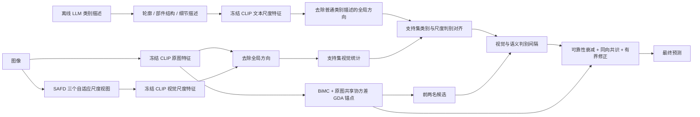

# SAFD 双模态尺度分支：实现、实验与分析

本设计在 `codex/safd` 上实现冻结 CLIP 的视觉和语义尺度分支。语义频率是
LLM 生成的三组可见属性描述，没有对文本向量的维度做 FFT。默认复用已有
`description/cub200_frequency_descriptions_deepseek.json`，每类每尺度 5 个候选。
LLM 只在离线生成描述时使用；分类和增量阶段不调用 LLM、不反向传播。

## 完整推理路径



| 分支 | 视觉输入 | 语义描述内容 |
|---|---|---|
| 原始 | 原图 | BiMC 原有类别提示与普通 LLM 描述 |
| low | 少量 SAFD 项的近似视图 | 模糊后仍可见的轮廓、整体比例、大面积颜色 |
| middle | 中等数量项的近似视图 | 部件形状、位置关系、中等尺度斑纹 |
| high | 原图加有限幅值的 SAFD 剩余细节 | 局部纹理、细小斑点、条纹和边缘 |

SAFD 的项按数据自适应能量选取，**不是严格按物理频率排序的径向频带**。
这三组是近似复杂度和语义空间尺度的对应假设。自然视图还混入原图以减少
CLIP 输入分布偏移，因此不能声称 high 视图只包含高频、或已证明尺度对应。
已有 SAFD 数值实现和参数见 `docs/safd_experiments.md`。

### 1. 原始预测锚点

完整 BiMC 得分与原图共享协方差 GDA 概率按基类校准的 alpha 混合。
GDA 的均值来自各类支持集，协方差仅来自基类训练图像的类内变化；类先验均匀。
新增类只添加均值等统计，不更新共享协方差或 CLIP。
`UNCERTAINTY.ALPHA=0` 可以精确保留 BiMC。

### 2. 去除全局方向

每幅图像的尺度特征 z_b 对其自身归一化原图特征 z_0 去投影，再归一化：

`r_b = normalize(z_b - <z_b,z_0> z_0)`。

每条尺度描述 t_cbk 对该类普通 BiMC 描述均值 t_c0 做同样处理。
低于 1e-6 的残差置零，避免把浮点消去误差放大成方向。
图像支持统计在**逐样本去投影之后**计算，均值保留长度以表示方向集中程度。
这是去除一个全局方向，不能解释成数学意义上所有语义冗余都被消除。

### 3. 支持集判别对齐

每类每尺度的候选描述对齐分数是：

`q_cbk = <r(t_cbk), v_cb> - max(max_{j!=c}<r(t_cbk),v_jb>, max_{a!=b}<r(t_cbk),v_ca>)`。

其中 v 是支持集残差均值的单位方向。用 q 选 top-k，再按温度 softmax
加权候选。它同时考虑本类相似度、其他类混淆和本类其他尺度混淆。
在当前所有已见类别之间重算竞争关系；不读取任何查询或未来类图像。
历史类支持统计和离线文本候选保持不变，竞争类集合增长时对应权重允许变化。
语义描述之间天然有共享内容；跨尺度惩罚是一项可消融的启发式约束。

每类每尺度可靠性为以下量的乘积：正的图文余弦、本类支持残差均值长度、
`n/(n+SHOT_TAU)`，以及类别/尺度间隔的 `min(1,2 sigmoid(margin/temperature))`。
它只衰减证据，范围 [0,1]，不是经过概率校准的置信度。
方向集中程度包含支持分散程度，但不是完整的协方差不确定性模型。
默认 top-k=3、temperature=0.07、SHOT_TAU=5，属于待验证初始设置。

### 4. 候选对共识与融合

对锚点前两名 a、b，分别计算视觉原型和语义原型的逐尺度余弦差。
各用基类 fit 伪序列上的绝对间隔中位数归一化，并通过 tanh 限幅。
某尺度视觉与语义同向时，保留两者绝对值较小的证据；不同向则置零。
再乘 a、b 可靠性的较小值，以及查询残差能量衰减。
使用固定尺度权重分母，防止低可靠性分支被重新归一化成高置信度。

`new_log_ratio = log(anchor[a]/anchor[b]) + lambda * evidence`。

证据绝对值不超过 1。只有原始 log ratio < lambda 的查询需要额外编码。
实现仅在赢家确实需要翻转时重分配 a、b 的得分，并保持二者总质量、其余类
得分不变。`lambda=0` 精确保留锚点并跳过全部查询尺度编码；支持尺度统计
仍要计算。该方法无法纠正真实类不在锚点前两名中的错误。

`visual_only` 只使用支持视觉集中程度和 shot 衰减，输出不依赖语义候选；
`semantic_only` 仍有支持集语义对齐，但判别间隔只来自语义原型。
`no_alignment` 同时取消判别候选选择和可靠性衰减，是组合消融。
`ordinary_text` 从每类普通描述按文本顺序均匀抽取 5 条，并重复到三个尺度；
不借助图像选择此子集。原始 BiMC 锚点仍用全部普通描述。CUB 各类普通描述
数量不同，这个固定预算控制可以避免描述数量差异导致堆叠失败。

## 基类校准与训练自由的准确表述

先沿用原图 GDA 的类互斥 fit/validation 划分选择 ridge、alpha、temperature。
再在 fit 类的伪增量序列拟合六个尺度间隔标度；在与锚点相同的 validation
序列选择 lambda。图像原型、文本候选选择和类别竞争关系每个 episode 都从
其支持图像重新建立，绝不能复用该类全部训练样本生成的对齐统计。
验证记录使用 fit 类协方差，避免误用已在全部基类重拟合的部署协方差。

默认优化各伪增量阶段 old/new 等权准确率，并要求 old、全部增量类、历史
增量类、当前新类各组相对**选定锚点**的下降不超过 0 个百分点，空组忽略。
零 lambda 永远可行；同分取最小 lambda。该约束是验证选择规则，不是实际
测试不下降的保证，也不会撤销锚点相对 BiMC 本身可能造成的新类损失。

校准后 GDA 协方差在全部基类训练数据重拟合，所有超参数固定。增量阶段
只增加当前类统计和文本候选，历史样本级特征在会话边界释放。
可以称为**冻结 CLIP 的梯度自由适配 / training-free adaptation**，应说明
使用带标签支持集统计和基类验证校准。它不是无监督、零样本或完全无需拟合。

锚点和修正强度复用同一验证集，存在顺序调参过拟合；验证准确率不能作为
独立泛化证据。伪序列候选数 10/15/20 与正式 100–200 类也有差异。

## 运行方法

在仓库根目录运行，替换服务器数据路径。核心矩阵含 8 方法 × 3 种子：
BiMC、零 GDA、原图 GDA、FFT 视觉 GDA、SAFD 视觉 GDA、零双模态修正、
FFT 双模态、SAFD 双模态。各方法重新使用同一网格和协议校准。

```bash
# 先审查完整命令，不运行实验
python tools/run_safd_dual_experiments.py --suite core --seeds 1 2 3 --dry-run --opts DATASET.ROOT /path/to/datasets

# 正式执行，逐任务落盘；完成结果可按指纹复用
python tools/run_safd_dual_experiments.py --suite core --seeds 1 2 3 --execute --opts DATASET.ROOT /path/to/datasets

# 11 项补充消融，先固定方案再评估，避免按测试集调参
python tools/run_safd_dual_experiments.py --suite all --seeds 1 2 3 --variants visual_only semantic_only average no_alignment no_residual ordinary_text structured_text permuted_text low_only middle_only high_only --execute --opts DATASET.ROOT /path/to/datasets

# 仅基类校准，确认参数与对齐诊断，不加载任何 benchmark 测试图像
python main.py --data_cfg configs/datasets/cub200.yaml --train_cfg configs/trainers/bimc_safd_dual.yaml --opts DATASET.ROOT /path/to/datasets TRAINER.BiMC.DUAL_FREQUENCY.BASE_ONLY True OUTPUT_DIR outputs/safd_dual_base_validation
```

若与已有矩阵共享支持，设置 `--support-root` 指向同一支持文件根目录，且
数据配置及 `DATASET.*` 覆盖一致。代码和配置指纹有变化时使用新输出目录，
不能将新配置命名为旧方法后直接混用旧指标。
默认 ridge 网格新增 10，因为之前所有 GDA 结果都选到了原网格上界 1；
核心矩阵统一使用扩大后的网格，所以新 `original_gda` 并非旧报告的重复实验。

已有离线描述可直接用。需要重新生成时，仓库中
`tools/generate_cub200_frequency_descriptions.py --help` 和
`tools/generate_cub200_frequency_descriptions_deepseek.py --help`
提供 OpenAI-compatible/DeepSeek 离线生成与恢复流程；API 密钥通过环境变量
传入。已有文件共 200 类 × 3 尺度 × 5 候选。JSON 格式正确不等于属性正确；
生成后应人工审查，不能用 benchmark 查询标签筛选描述。

## 输出及结果审查

每次运行保存 `config.yaml`、`support.json`、`uncertainty_calibration.json`、
`dual_frequency_calibration.json`、`metrics.json`、`checkpoint.pt` 和每会话预测。
双模态校准记录包含候选 lambda 的分组纠正/破坏计数、约束是否可行、协议
哈希、描述文件哈希、fit 对齐均值。检查点保存尺度标度、强度和支持统计。

`reference_accuracy` 始终指原始 BiMC；`anchor_accuracy` 指原图 GDA 锚点。
`frequency_prediction_diagnostics` 直接比较最终方法和锚点，防止把 GDA 收益
误归因于频率分支。`anchor_scores_exact_equal` 可用于零修正检查。
逐查询文件另存 `anchor_prediction`、`anchor_second_candidate`、是否额外编码
及 evidence；未计算证据为 NaN，表示未计算，不是意见冲突。

矩阵汇总报告对 BiMC、原图 GDA、FFT 双模态和 SAFD 视觉 GDA 的配对差值，
并审计支持样本一致性、基类协议一致性、各双模态运行的锚点预测是否等于
独立原图 GDA，以及零双模态修正是否完全相同。汇总同时提供全部会话累计
fit/eval 时间；历史 `eval_seconds` 字段仍是最后一会话时间。
保留张量字节不是峰值 GPU 显存，不包括冻结 CLIP。

## 现有证据、分析和建议

用户提供的 CUB 服务器结果，3 种子均值（准确率为 %）：

| 方法 | Final | Average | Base | Novel |
|---|---:|---:|---:|---:|
| BiMC | 72.500 | 75.778 | 78.922 | 66.223 |
| 原图 GDA | 74.491 | 77.518 | 81.878 | 67.270 |
| FFT 视觉 GDA | 74.111 | 77.273 | 81.611 | 66.780 |
| SAFD 视觉 GDA | 73.944 | 77.115 | 81.506 | 66.553 |

这些数字来自 `outputs/safd_cub/summary.json` 的既有实验，不是新双模态实现
的结果。原图 GDA 比 SAFD 视觉 GDA 高约 0.547 pp，说明目前额外视图并未
证明有独立增益。新设计要针对这个缺口验证：尺度描述是否增加了与视觉
分支互补、且能纠正原图 GDA 的证据，而不是仅增加维度或重复类别信息。

优先建议：

1. 先跑核心三种子矩阵，重点比较 SAFD 双模态与**原图 GDA**。同时看 Final、
   Novel、harmonic 和新类破坏计数；只超过原始 BiMC 不足以证明新模块有用。
2. 检查 lambda 是否多数为零。为零代表当前验证协议未认可修正，应报告为
   回退；不能手动强制非零再把 benchmark 提升作为自动方法成绩。手动非零
   只用于验证推理执行和研究失败原因。
3. 比较普通描述、尺度错配、structured-only 和三单尺度消融。如果错配不
   降、普通描述相当，则尺度语义对齐的机制证据不足。独立校准消融检验的是
   完整方法的适配能力；另可在基类固定完整方法的 lambda 做机制控制实验。
4. 观察逐尺度 `class_margin`、`band_margin`、`reliability`。若低可靠性普遍
   出现，先核查描述真实性、自然视图的原图占比、残差方向是否太弱，以及
   CLIP 对细粒度特征是否敏感；这些因素尚未经过实验确定。
5. 若支持统计稳定但 top2_headroom 很低，前两名修正空间已受限。扩展候选
   集或引入全类别残差应作为新的受控设计，避免直接放大 lambda 破坏确定样本。
6. SAFD 当前比 FFT 慢：旧结果最后会话约 58.28s 对 38.47s。先确认独立准确率
   收益再优化实现。本实现已在 lambda=0 和不可翻转的查询跳过辅助编码，
   但并不减少支持集分解成本。
7. 在方案冻结后增加种子和另一个数据集。三种子不足以支持统计显著性或
   普遍优于 FFT 的结论。创新点宜围绕**语义尺度约束的自适应视觉分解、
   支持集类别/尺度判别对齐、增量场景可靠性约束的双模态共识修正**展开；
   不宜仅以三种 prompt 或 FFT 换 SAFD 为充分创新证据。

## 验证记录

实现验证覆盖：残差正交性与零残差、候选判别选择、few-shot 衰减、共识
冲突归零、得分质量保持、前两名修正边界、查询 batch 独立、基类校准的
类/样本互斥、查询变化不影响支持对齐、三会话冻结与缓存释放、零修正跳过
编码、base-only 不读取测试集、实际 Runner 的语义控制和整个配置矩阵。

2026-10-06 验证结果：

- 全量 206 项 unittest 通过，包含本次新增的 16 项；`git diff --check` 通过。
- 真实 ViT-B/16、GTX 1080 Ti、torch 2.6.0+cu126，在已有 CIFAR 图像的
  12 类子集上完成原图 GDA、零双模态、自动双模态、手动非零双模态各三个
  会话。支持文件及锚点校准协议一致；全部双模态锚点预测与独立原图 GDA
  相同，零修正完全一致且查询辅助编码为零。
- 手动 lambda=0.6 运行的三个会话分别额外编码 72、90、108 个尺度视图，
  确认实际 SAFD/CLIP 查询分支执行。最终预测没有额外变化；自动校准选
  lambda=0。该结果不能作为新方法有效性的证据。
- 冒烟测试的语义文件是已有 CIFAR LLM 普通描述按关键词组成的测试夹具，
  用于验证编码/解析/融合，不是新生成的空间尺度描述，也不是正式实验。
  另外用真实 CLIP 编码了 CUB 正式描述文件前三类，输出 [3,3,5,512] 且有限。
- 原始日志、配置、预测、检查点和审计位于 `outputs/safd_dual_real_smoke/`；
  自动测试日志在 `.codex_tmp/safd_dual_tests.log`，均作为本地忽略产物保留。

完整 CUB 新方法准确率仍需服务器实验。当前验证确认实现和实验协议可运行，
没有证明新双模态方法优于原图 GDA 或 FFT 双模态方法。
